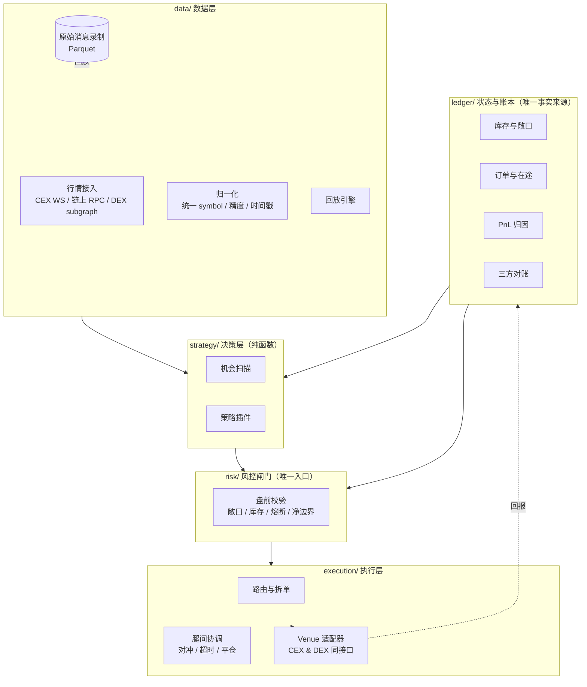

# 加密套利框架 — 架构计划 v0.1

> 目标：让「发现价差 → 风控 → 执行 → 记账」这条链路只写一次，之后每加一个策略
> （跨所现货、期现基差、三角、同链跨 DEX、DEX↔CEX、资金费率、跨链）都只写策略逻辑本身。

> **2026-09-22 补充：token-perp basis 已通用化（不再"港股专属"）。**
>
> - `strategy/token_perp_basis.py::TokenPerpBasisStrategy` = "链上股票代币多 +
>   USD 线性永续空"，输入多一个 `listing_market`（HK/US）与
>   `core/hk.py::QuoteConversion`（计价币→USDT 的带来源/失效观测）。
>   `strategy/hk_basis.py::HKBasisStrategy` 只是它的 HK 默认值入口，行为不变。
> - **发现分三层**，只有中间一层是发现的产出：发行方宇宙 → 可配对候选 → 可执行白名单。
>   两个配置开关把"能看"和"能采纳"分开：`token_scan_countries`（能看哪些上市地）/
>   `token_adopt_markets`（能热加入价格监控的上市地）。扫描到但未采纳的市场行
>   只进 `run_summary` 的 `report_only`，**发现从不写执行白名单**。
>   **2026-09-22 起 US 也在"能采纳"里**（`["HK","US"]`，operator 指示："现在开始
>   对这114个公司也进行监控"），入口仍是两道闸门：在 754 ÷ 181 的**交集 114 之内**
>   （`token_scan_perp_gate_markets`）+ X Layer 池深度 ≥ `min_pool_depth_usd`。
>   被采纳的美股名字 `mapping_verified = false`、不在执行白名单，
>   `execution_blockers()` 写"份额映射未核验" → **监控 ≠ 可执行**。
>   美股新标的走**轮转报价**（`quote_slice_markets=["US"]`、
>   `quote_slice_assets_per_cycle=3`），避免一次性涌入拖垮 60 秒采样循环。
> - **看板按上市地平铺**（`market_coverage_html`）：每个上市地的"监控中标的 /
>   本周期有报价 / 本轮候选"，下面一行是**发现漏斗**（发行方宇宙 → 无 OKX 股票永续
>   未探针 → 交集内 / 本轮探针 → 本轮新增有池候选 → 执行白名单）。漏斗来自最近一次完成的扫描，
>   写在独立事件 `token_universe_scan` 里（`scan_age_ms` 说明它有多旧），
>   重启后由 `_restore_last_scan_report()` 读回，不会空白 30 分钟。
>   层计数分两种口径：`layers.probed` 是整个交集（市场级上限，轮与轮之间不变），
>   `layers.probed_this_round` 是这一轮真的花掉探针的数量（受
>   `token_scan_max_probes_per_round` 轮转）；`layers.pairable_candidates`
>   只统计**本轮新采纳**的名字，`already_monitored()` 会让早先几轮进来的不再出现，
>   所以看板写的是「本轮新增有池候选」而不是「有池候选」。
>   方向表（`dashboard_html`）的**判定**列来自 `xstocks_screen`（只比两个价格），
>   而策略路径对未签名的 `mapping_verified = false` 行在算仓位前就拒掉
>   （`unverified_or_expired_share_ratio_fx_mapping`），因此这类行的判定格补
>   「份额映射未核验，不可执行」：筛选读数和可执行性在同一行分开说。
> - **归一化层的爆炸半径**（2026-09-22 实测教训）：`parse_contracts` 对"规格 ≤ 0"
>   的行**丢弃并上报**（`source_error` → `contract_spec_skipped:<instId>`），
>   不再让整场解析失败。原来那样做的后果是：Gate 的 `SOXS_USDT`
>   （`order_size_min = 0`）把整个 Gate 从注册表里删掉，而其余 7 家照常采样，
>   summary 里看不出任何异常。**0 是"未知"，不是"没有最小量"。**
>   （Gate 本身已于 2026-09-22 停止监控；这条教训与具体场馆无关，任何一个
>   场馆的一行坏数据都不能打掉整场。）
> - **池子五状态**（`core/liquidity_state.py`）：只有 `exact_in_quote_available`
>   可执行；`slot0` 初始化价与历史成交不作执行价；换算出问题即 `quote_unusable`。
> - **数量模型**（`core/sizing.py`）：`token × shares_per_token ÷
>   shares_per_perp_unit ÷ contract_multiplier → 向下取整 lot_size`，全 `Decimal`，
>   负残差/未知乘数拒绝。
> - **成本**（`core/cost_table.py`）：per asset/venue 覆盖全局已审核值，未知字段报错；
>   只描述成本，不设阈值。完整落地对照见 `docs/research/us-mapping-2026-09-22.md`。
> - **两个"异步读取 vs 新鲜度窗口"的口径坑**已修，两者都是"没采样被印成没数据"：
>   ① 链上池读取异步（~3 分钟一批）而窗口 2 分钟 → 新增 `pool_state` 状态
>   `pool_read_stale`（本轮未采样），只有"没配池子"才是 `no_pool`；
>   ② 后台发现扫描的结果原先只在 30 分钟 due 时才被收走 → 改为每轮先收件、
>   到点才开新扫（`_token_scan(..., due=)`），**扫描频率不变**。

---

## 0. 三个核心判断

**判断 1：瓶颈不在"发现价差"，在状态一致性和执行。**
价差扫描器一天就能写出来。真正决定赚不赚钱的是：多交易所余额/头寸/在途订单的统一视图、
一条腿成交另一条腿没成交怎么办、以及成本模型是否算准。
**"准确"来自账本和归因，不来自信号。** 大多数自建套利系统死于"不知道自己到底赚没赚"。

**判断 2：必须模块化，但模块边界要画在"状态"上，不是画在"策略"上。**
新手常见的分法是把每个策略写成一个独立脚本，各自调 API。第 3 个策略时就会崩。
正确的切法是：**策略是纯函数插件，Venue 是适配器，风控是唯一闸门，账本是唯一事实来源。**

**判断 3：先做慢速策略打通端到端，再下沉热路径。**
框架的模块边界如果设计正确，把某个模块从 Python 换成 Rust 是替换实现，不是重写。
顺序反了（先追求低延迟）会写出一个又复杂又验证不了的系统。

---

## 1. 策略分层 —— 先定这一层，它决定技术栈

策略按"延迟预算"分三类，不同类需要完全不同的基础设施。**不要一开始就同时做三类。**

| 层级 | 典型策略 | 时间预算 | 主要瓶颈 | 合适的技术形态 |
|---|---|---|---|---|
| **A 热路径** | CEX↔CEX 跨所吃单、三角套利 | 1–50 ms | 网络 RTT、内存订单簿、同机房 | 常驻进程、Rust/Go 热路径、VPS 与目标交易所同区 |
| **B 中速** | 同链跨 DEX、DEX↔CEX、L2 套利 | 0.3–15 s | 出块时间、RPC 延迟、gas 竞价、MEV | Python/TS + 自建/多源 RPC、交易模拟、私有 bundle 通道 |
| **C 慢速** | 期现基差、资金费率、跨所搬砖、跨链 | 1 min – 数天 | 资金成本、库存、提币/桥延迟、数据质量 | Python 足够，重点是数据管道和记账 |

**建议路径：C → B → A。**
Tier C 能用 Python 快速验证并立刻产生真实反馈，同时框架的模块边界与 A/B 完全一致。

> 关键取舍：Tier A 要求真金白银的基础设施投入（VPS、多区域部署、低延迟语言），
> 在策略本身还没被验证赚钱之前，这笔投入大概率是浪费。

---

## 2. 模块划分



### 各模块职责（含"不做什么"，边界最容易在这崩）

| 模块 | 职责 | 明确不做 |
|---|---|---|
| `core/` | 共享类型：AssetId / PairId / 金额精度 / 时间戳 / Instrument 元数据 | 任何 IO |
| `data/` | 连接交易所与链、归一化、录制、回放、健康检查 | 不做交易决策 |
| `strategy/` | 输入市场快照+组合状态，输出声明式 Intent | **不调 API、不签名、不管理仓位、不算最终份数** |
| `risk/` | 所有 Intent 的强制闸门，可裁剪/拒绝 | 不产生信号 |
| `execution/` | Intent → 具体订单/交易，管在途、重试、腿间协调 | 不判断"是否该做这笔" |
| `adapters/venues/` | CEX 与 DEX 的**同一套接口**实现 | 不含策略逻辑 |
| `ledger/` | 余额、在途、成本、PnL、对账 | 不缓存行情真相 |
| `ops/` | 配置、密钥、指标、告警、kill switch、审计日志 | —— |
| `research/` | 回测、参数扫描、成本敏感性、机会分布分析 | 不连实盘下单 |

**"CEX 和 DEX 用同一个接口"是这个设计里最值钱的一条。**
如果 DEX 走另一条路径，那么"DEX↔CEX 套利"这类策略就会变成维护两套执行逻辑。

---

## 3. 核心接口草案

### 3.1 共享类型（`core/types.py`）

```python
AssetId  = str   # "eip155:1:0xa0b8..." | "solana:mainnet:EPjF..." | "cex:USDT"
VenueId  = str   # "binance" | "okx" | "uniswap_v3@base" | "jupiter@solana"
PairId   = str   # 规范化 "BASE/QUOTE"，quote 统一命名空间
Qty      = Decimal   # 数量一律 Decimal / 定点整数，禁止 float（见反模式 #2）
Px       = Decimal
Ts       = int       # 微秒 epoch

@dataclass(frozen=True)
class Instrument:
    pair: PairId
    base: AssetId
    quote: AssetId
    tick_size: Decimal
    lot_size: Decimal
    min_notional: Decimal
    contract_multiplier: Decimal = Decimal(1)

@dataclass(frozen=True)
class OrderBook:
    venue: VenueId
    pair: PairId
    bids: tuple[tuple[Px, Qty], ...]   # 降序
    asks: tuple[tuple[Px, Qty], ...]   # 升序
    venue_ts: Ts      # 交易所/链上事件时间
    recv_ts: Ts       # 本地接收时间（用于延迟分析与 staleness 判定）
    seq: int          # 序列号，用于检测丢包
```

> 三个时间戳必须都留：只有本地时间就无法区分"行情旧"和"网络慢"，
> 而这两者的处置方式完全不同（前者停止交易，后者换线路/换 VPS）。

### 3.2 Venue 适配器（`adapters/base.py`）

```python
class VenueAdapter(Protocol):
    id: VenueId
    kind: Literal["cex", "dex"]

    def instruments(self) -> list[Instrument]: ...
    def subscribe_book(self, pairs: list[PairId]) -> AsyncIterator[OrderBook]: ...

    def balances(self) -> dict[AssetId, Balance]: ...       # 含可用/冻结/在途
    def quote(self, req: QuoteRequest) -> Quote: ...        # 只读估价，绝不下单

    async def execute(self, order: OrderRequest) -> OrderAck: ...
    async def cancel(self, venue_order_id: str) -> None: ...
    def open_orders(self) -> list[OpenOrder]: ...

    def fee_schedule(self, pair: PairId, liquidity: Liquidity) -> FeeSchedule: ...
    def transfer(self, req: TransferRequest) -> TransferHandle: ...  # 慢通道：充提/跨链桥
```

`quote()` 与 `execute()` 分离是**回测/纸面交易能成立的前提**：
纸面模式调用真实的 `quote()`，只把 `execute()` 换成模拟撮合器。

### 3.3 策略与 Intent

```python
class Strategy(Protocol):
    name: str
    def warm(self, history: HistoryView) -> None: ...
    def on_snapshot(self, market: MarketSnapshot) -> list[Intent]: ...

@dataclass(frozen=True)
class Intent:
    kind: Literal["open", "close", "hedge", "rebalance"]
    legs: tuple[Leg, ...]      # Leg: asset / side / qty 或 notional / venue 偏好 / max_px
    net_edge_bps: Decimal      # 已扣费的净边界（风控据此判断，而不是毛价差）
    ttl_ms: int                # 过期作废，防止陈旧信号下单
    group_id: str              # 同一机会的多腿共享，用于原子性与对冲协调
```

**Intent 是声明式的**：策略说"我想在 A 买、在 B 卖"，不说"给 binance 发
`POST /api/v3/order` type=MARKET"。后者是 execution 层的事。

### 3.4 风控闸门（唯一的下单入口）

```python
class RiskGate:
    def check(self, intent: Intent, portfolio: PortfolioView, market: MarketSnapshot) -> Decision
    # Decision: ALLOW | RESIZE(qty) | REJECT(reason)，每次都写审计日志
```

必须内置的硬规则：

- 单笔 / 单 venue / 单资产名义上限
- 组合级日亏损熔断 + 全局 kill switch（一处触发，全通道停）
- 行情 staleness 与序列号断裂检测
- 净边界下限（`net_edge_bps` 低于阈值直接丢弃）
- 库存不足（禁止没有任何缓冲的裸卖）
- gas / priority fee 预算上限
- 对手方集中度（别把全部资金压在一家所）

---

## 4. 状态与账本：整个系统最容易被低估的部分

三本账必须能对上，对不上就要告警：

1. **Venue 自报**：交易所 API / 链上余额查询
2. **本地账本**：我记录的每一笔 fill、手续费、gas、转账
3. **实际结算**：链上确认 / 交易所最终余额

对账任务定期跑，输出「未解释差异」。差异是最有价值的运维信号：
它通常意味着漏记手续费、精度截断、或对 DEX 交易的实际成交价理解有误。

**PnL 归因维度**：策略 → 机会实例 → venue 腿 → 成本项。
只有归因到"机会实例"，你才能回答"这个策略上周到底赚了多少，是哪个环节吃掉的"。

### Inventory-first vs Transfer-first

**绝大多数能稳定赚钱的套利靠预置库存，不靠转账。** 跨所转账/跨链桥的延迟（分钟到小时）
和费用决定它不可能出现在热路径上。

所以：

- 每个 venue 的库存是一等公民，框架要能算出"当前偏斜"和"最优再平衡点"
- 转账是独立的**再平衡通道**（低频、可调度），与交易通道解耦
- 策略在 Intent 里可以声明期望的库存分布，由 execution 层决定是"吃库存"还是"触发再平衡"

---

## 5. 执行层细节清单

### CEX

- 下单走 REST，**成交确认必须走 WS 私有频道**，不能只信 REST 返回值
- 每个请求带唯一 `clientOrderId`，保证重试幂等
- 精度/最小名义对齐要在客户端做好，别依赖服务端报错兜底
- rate limit 做预算管理（weight 池 + 主动降速），别等 429
- 资金分子账户隔离；提币地址白名单提前配置好（新地址有冷却期）
- 市价吃单优先用 IOC/FAK，避免留下非预期挂单

### DEX

- **nonce 管理**：单钱包同时只能有一个写入者；所有签名请求走单一进程/单一串行队列
- token approval 一次性做够，但额度可控
- 每条链上常备 gas 代币
- 发送前必须 `eth_call` / 交易模拟，检查是否会被 revert、滑点、以及**蜜罐/转账税**这类合约陷阱
- priority fee 要有策略（固定 + 动态抢跑），别写死
- 需要私有 mempool / bundle 类通道降低被夹风险
- RPC 多源 + 自动切换，条件允许时自建节点；注意 RPC 自身的限流
- 处理 reorg、pending 卡单（替换交易：同 nonce 提价）、失败交易的资金损耗

### 跨所腿间协调（永远不原子）

链上两条腿可以原子（同一笔交易 / 闪电贷），**跨所永远做不到原子**。必须显式设计：

1. 先执行流动性更好/更容易成交的那条腿（通常是先 hedge，后平）
2. 另一条腿超时未成交 → 主动平掉已成交腿（要有自动平仓路径，不能只告警）
3. 部分成交 → 按最小腿对齐，剩余部分要么追、要么撤
4. 每个 `group_id` 的腿间状态机要可观测、可重放

---

## 6. 成本模型（必须是 Opportunity 的一部分）

策略不应该看到毛价差。到策略手里的必须是**扣完成本的净边界**：

```
净边界 = 毛价差
       − 双边手续费（按实际 VIP 档 / maker-taker 区分）
       − 滑点（用真实盘口深度算，不是拍脑袋 bps）
       − gas / priority fee（换算成计价资产）
       − 提币费 / 跨链桥费（若涉及再平衡，按摊销计入）
       − 资金占用成本（年化资金费率 × 占用时长）
       − 失败与回滚预期损耗（历史失败率 × 单次损失）
       − 安全边际
```

所有费率、gas 参数、滑点假设都放配置，且**能被回测扫描**——
很多"看起来赚钱"的策略在加上真实手续费档位和滑点后就归零了。

---

## 7. 建议的仓库结构

```
arb/
├── core/                 # 类型、精度、Instrument 注册表、时间
├── config/               # 配置即代码（yaml）+ 密钥引用（不落明文）
├── data/
│   ├── feeds/            # CEX WS 接入、链上事件、RPC 池
│   ├── normalize/        # 归一化、symbol 映射表
│   ├── record/           # 原始消息落盘（Parquet）
│   └── replay/           # 确定性回放引擎
├── strategy/
│   ├── base.py
│   ├── xvenue_spread/    # 跨所价差
│   ├── basis/            # 期现基差
│   ├── dex_cex/          # 同链 DEX 跨所
│   └── funding/          # 资金费率
├── risk/
├── execution/
│   ├── router.py
│   ├── legs.py           # 腿间协调与超时平仓
│   └── adapters/
│       ├── cex/{binance,okx,...}.py
│       └── dex/{evm, solana, ...}.py
├── ledger/
│   ├── positions.py
│   ├── costs.py
│   ├── pnl.py
│   └── reconcile.py
├── wallet/               # 签名、nonce 串行化、密钥后端
├── research/             # 回测、参数扫描、机会分析 notebook
├── ops/                  # 指标、告警、kill switch、审计日志
└── apps/
    ├── scanner/          # 只监控不下单
    ├── paper/            # 真实行情 + 模拟撮合
    └── live/             # 实盘
```

**扫描器、纸面交易、实盘共用同一份策略代码**，区别只在装配哪些模块。

---

## 8. 技术栈建议（基于本机已有环境）

| 用途 | 选择 | 理由 |
|---|---|---|
| 主框架（数据/策略/风控/账本/回测） | **Python 3.14 + uv** | 生态最好，研究迭代最快；uv 管理依赖与环境 |
| 行情网关 / 监控面板 | **TypeScript + bun** | WS 并发处理舒适，面板开发快 |
| 热路径（Phase 5 后再考虑） | **Rust** | 只在确认需要亚毫秒时才引入，不要提前 |
| 行情存储 | **Parquet + DuckDB** | 单机即可扫描海量盘口快照，无需起服务 |
| 状态/账本 | **SQLite（起步）→ Postgres** | 起步别上分布式数据库 |
| 模块间通信 | 起步**进程内 async**，需要拆分时用 Redis Streams / NATS | 别一开始上 Kafka |
| 部署 | 云 VPS（贴近交易所区域）；DEX 可另起就近节点 | 本机开发，VPS 跑实盘 |

---

## 9. 路线图

| 阶段 | 交付物 | 验证目标 | 预估 |
|---|---|---|---|
| **P0** 骨架 | Instrument 注册表、1 个 CEX 只读适配器、录制器、回放引擎 | 能确定性重放一段真实行情 | 3–5 天 |
| **P1** 只监控 | 多所行情归一化、价差扫描器、监控面板/告警 | **看清机会分布，据此选策略**（关键决策输入） | 1 周 |
| **P2** 可验证 | Ledger、RiskGate、纸面交易（真实行情 + 含费滑点模拟） | 回答"加了成本还剩多少" | 1–2 周 |
| **P3** 单腿实盘 | 小资金单腿能力（DEX 单笔 swap / CEX 单笔 taker）、签名与 nonce、对账闭环 | 打通"真实下单 → 成交 → 记账 → 对账" | 1–2 周 |
| **P4** 双腿策略 | 第一条完整双腿策略（建议 Tier C：期现基差 或 同链两 DEX） | 端到端盈利或明确否证 | 2–3 周 |
| **P5** 检验抽象 | 接入第二个 venue 家族（DEX 或第二家所） | **如果改动只限于新增 adapter，架构成立；否则回去修边界** | 1 周 |

P1 的监控阶段是**决策输入**，不只是功能：拿到真实机会分布（频率、幅度、持续时间）之后，
你才知道该往 Tier A/B/C 哪个方向投入基础设施。

---

## 10. 反模式清单

1. **策略里直接调交易所 API** → 无法回测、无法统一风控、无法纸面交易
2. **用 float 表示价格或数量** → 必须 Decimal 或定点整数；否则对账永远差一点点，且是随机差
3. **只记本地时间戳** → 无法区分行情陈旧与网络慢
4. **多进程共用一把私钥发交易** → nonce 冲突，资金卡在 pending
5. **把转账放在热路径** → 延迟决定它不可能赚钱
6. **策略直接看到毛价差** → 会做出大量"算完成本亏钱"的交易
7. **没有 kill switch / 日亏损上限** → 一次 bug 吃掉数月收益
8. **不做对账** → 无法归因，无法知道自己是否真的赚钱
9. **一开始就上微服务 / Kafka / 分布式** → 复杂度吃掉全部开发预算
10. **忽略交易所 rate limit 与 RPC 限流** → 关键时刻被限速，错过所有好机会

---

## 11. 待你确认的决策点

这些会实质改变设计，先确认再进入 P0：

1. **资金规模与最大可承受单笔亏损** → 决定是否需要拆账户、是否需要保险/对冲层
2. **目标 venue 清单与所在链** → 决定适配器开发顺序（也是 P0 的起点）
3. **优先策略族** → 若已确定，P1 的监控扫描器可以直接针对该族设计
4. **实盘运行位置** → 本机 / 云 VPS / 多区域；影响延迟预算与成本
5. **是否接受"先只监控 2 周再下单"** → 我强烈建议这样，但这需要你认可

---

## 12. 合规与运维边界

- 交易所 API 条款通常限制某些自动化交易行为，部分司法辖区对衍生品与 DEX 有额外限制 —— 上线前确认
- 每笔交易都要留完整审计轨迹（含失败和撤单），这既是税务需要也是归因需要
- 密钥管理：实盘密钥不进代码库、不进日志；建议独立签名进程 + 受限权限 API key（禁用提币权限）
